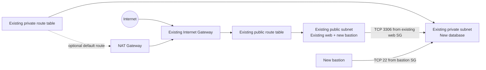

# UNLOX VPC Multi-Tier Project

This stack completes the existing UNLOX AWS VPC assignment network. It reuses the VPC, public/private subnets, route tables, internet gateway, and running web server already in the account. Terraform adds the bastion host, private MariaDB server, security groups, subnet NACLs, and an optional NAT Gateway for private package downloads.

## Existing network

- VPC: `10.0.0.0/16` (`vpc-0382ebb9de9fd682d`)
- Public subnet: `10.0.1.0/24` (`subnet-0b2bd31cacabaa1fc`)
- Private subnet: `10.0.2.0/24` (`subnet-07cc5b2525341e0a2`)
- Existing web server: `UNLOX-WEB-SERVER` (`i-0c8f66c26622c32ff`), using `launch-wizard-2` (`sg-0136400a11ab74d69`)
- Existing EC2 key pair: `UNLOX-EC2-KEY`

The private route table ID must be confirmed from the AWS console and set in `terraform.tfvars`. The private subnet has no internet route until the optional NAT Gateway is created.

## Architecture



The database has no public IPv4 address. Its security group accepts MySQL only from the existing web server security group and SSH only from the bastion security group. The bastion SSH rule is restricted to the administrator `/32` address. The existing web server security group is read-only in this stack and keeps its current SSH source rule. The custom NACLs replace the existing subnet associations, so review their rule matrix before applying; the existing web server is in the public subnet and will be affected by that association.

## Resources added

- Bastion EC2 instance in the existing public subnet
- MariaDB EC2 instance in the existing private subnet
- Security groups for the bastion and database
- Public and private subnet Network ACLs with ephemeral return-traffic rules
- NAT Gateway and private default route when `enable_nat_gateway = true`

The running web server and existing VPC resources are data sources and are not recreated or deleted by this stack.

## Before deploying

1. Install Terraform and configure credentials for the intended AWS account and `ap-southeast-2` Region.
2. Confirm the current administrator public IPv4 address and set it as `admin_cidr` with `/32`.
3. Confirm the private route table ID in the VPC console and set `private_route_table_id`.
4. Confirm the existing key pair is `UNLOX-EC2-KEY` and available in this Region.
5. Review `terraform plan` before applying. The default plan creates two `t3.micro` instances, two encrypted 8 GiB volumes, a NAT Gateway, an Elastic IP, security groups, NACLs, and a route. AWS charges apply to running resources, especially the NAT Gateway, public IPv4 address, EC2, and storage.

Terraform state contains infrastructure identifiers and should be kept private. Never commit `terraform.tfstate`, credentials, private keys, or `*.tfvars` files containing secrets.

## Deploy

Copy `terraform.tfvars.example` to `terraform.tfvars`, update the private route table ID and administrator `/32`, then run:

```powershell
terraform init
terraform fmt -check
terraform validate
terraform plan
```

After reviewing the plan and AWS charges, apply it with:

```powershell
terraform apply
```

## Verify

1. Open `http://<existing_web_public_ip>` and confirm the existing UNLOX site responds.
2. Confirm the bastion and database instances are running and pass status checks.
3. Confirm the bastion is in the public subnet and the database is in the private subnet with no public IPv4 address.
4. Confirm the existing route tables and IGW remain attached to the right subnets. If NAT is enabled, confirm the private route table has `0.0.0.0/0` to the NAT Gateway.
5. From the existing web server, run `mysqladmin ping --host=<database_private_ip> --port=3306 --connect-timeout=5`. The expected result is `mysqld is alive`.
6. From outside the VPC, verify the database private IP cannot be reached directly. Test SSH through the bastion with SSH ProxyJump:

```powershell
ssh -i "PATH_TO_PRIVATE_KEY.pem" -J ec2-user@<bastion_public_ip> ec2-user@<database_private_ip>
```

7. Capture genuine AWS console and browser screenshots for the VPC, subnets, route tables, IGW, NACLs, security groups, three project roles (existing web, bastion, database), website, successful database check, and failed direct database access from outside the VPC.

Only record live checks after running them in the target account.

## Cleanup

After assessment, run `terraform destroy` with the same `terraform.tfvars` if you no longer need the added resources. Review the destroy plan first. This stack does not delete the existing VPC, subnets, route tables, internet gateway, or web server.
