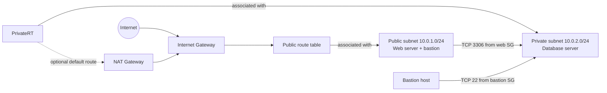

# UNLOX VPC Multi-Tier Project

This project builds the multi-tier AWS network described in the UNLOX minor-project brief: a public web server and bastion host, a private MySQL-compatible database server, and subnet-level Network ACLs.

## Architecture



The public and private route tables are separate. The private database has no public IPv4 address. Its default route remains local unless the optional NAT Gateway is enabled.

## Resources created

- VPC `10.0.0.0/16`
- Public subnet `10.0.1.0/24` and private subnet `10.0.2.0/24`
- Internet Gateway and public route `0.0.0.0/0`
- Private route table with the VPC local route and an optional NAT route
- Separate public and private Network ACLs with explicit return-traffic rules
- Web, bastion, and database security groups
- Amazon Linux 2023 EC2 instances for the web server, bastion, and database
- Nginx website on TCP 80; HTTPS ingress is allowed on TCP 443 for later TLS setup
- MariaDB server on TCP 3306 in the private subnet

The NACL rules include ephemeral ports because Network ACLs are stateless. The security groups remain the primary, stateful controls and limit database access to the web-server and bastion security groups.

## Before deploying

1. Install Terraform and configure AWS credentials for the intended account.
2. Choose the AWS Region. The default is `ap-southeast-2`, matching the existing UNLOX resources.
3. Create or select an EC2 key pair in that Region.
4. Find your current public IPv4 address and provide it as a `/32` CIDR. Do not use `0.0.0.0/0` for SSH.
5. Review the plan. This project creates three EC2 instances and, by default, one NAT Gateway. AWS charges for running resources, particularly the NAT Gateway, public IPv4 addresses, EC2, and storage. Set `enable_nat_gateway = false` only if the database package is already available without internet access; otherwise its initial package installation will fail.

Terraform state contains infrastructure identifiers and should be kept private. Never commit `terraform.tfstate`, credentials, private keys, or `*.tfvars` files containing secrets.

## Deploy

From this directory:

```powershell
terraform init
terraform fmt -check
terraform validate
terraform plan -var="key_name=YOUR_EC2_KEY_PAIR" -var="admin_cidr=YOUR_PUBLIC_IP/32"
```

After reviewing the plan and expected AWS charges, apply it with the same variables:

```powershell
terraform apply -var="key_name=YOUR_EC2_KEY_PAIR" -var="admin_cidr=YOUR_PUBLIC_IP/32"
```

Terraform prints the web and bastion public IPv4 addresses and the database private IPv4 address. The key-pair private key stays on your computer.

## Verify

1. Open `http://<web_public_ip>` and confirm the UNLOX page loads.
2. Confirm in EC2 that the web, bastion, and database instances are running and pass status checks.
3. Confirm the web and bastion instances are in the public subnet and the database is in the private subnet with no public IPv4 address.
4. Confirm the public route table has the VPC local route and `0.0.0.0/0` to the Internet Gateway. Confirm the private route table has the local route and, when enabled, `0.0.0.0/0` to the NAT Gateway.
5. From the web instance, run `/home/ec2-user/verify-db.sh`. The expected result is `mysqld is alive`.
6. From a computer outside the VPC, confirm the database private IP cannot be reached directly. Then connect to the database through the bastion with SSH ProxyJump:

```powershell
ssh -i "PATH_TO_PRIVATE_KEY.pem" -J ec2-user@<bastion_public_ip> ec2-user@<database_private_ip>
```

7. Capture genuine AWS console and browser screenshots for the VPC, subnets, route tables, Internet Gateway, Network ACLs, security groups, all three instances, website, successful database check from the web server, and failed direct database access from outside the VPC.

The Terraform package does not claim that AWS deployment or these live checks have been completed. Record results only after running them in the target account.

## Cleanup

After assessment, run `terraform destroy` with the same variables if you no longer need the lab. Review the destroy plan before applying it. This removes this Terraform stack only; it does not remove unrelated AWS resources.
